# Wake of the Ravager's figures, before and after

Each picture shows a Wake of the Ravager figure as shipped (front, side and combat frames, left of the
arrow) and the same frames after the change (right). Everything is drawn in Ravager's own colours
(Tyr's palette), at twice the game's size. How each change is made: [FIGURES.md](FIGURES.md).

- **Party:** the Obsidian Edition's figures (Shattered Lands' party with the mod's elves and half-elves).
- **Creature:** a Shattered Lands figure of the same kind swapped in.
- **Person:** a Shattered Lands figure matched by look, recoloured toward Ravager's look. Being redone the way the Obsidian Edition makes its half-elves (`tools/proto/people_dress.py`); this section is added when they are.
- **No SL equivalent:** Ravager's own figure restyled to sit with Shattered Lands' figures.
- **Map artwork (squashed):** tables, chairs, beds and other objects on the map, lowered to two-thirds of
  their height toward their base, as Shattered Lands' steeper view shows them (walls keep their height).

The pictures are made from the owner's own copies of the games by `tools/proto/figure_table.py`.

## Party (14)

| WR picture | What it is | Used for | Change | Status | Before → after |
|---|---|---|---|---|---|
| 25 | human man | the party | the Obsidian Edition's figure | done, seen in the game | 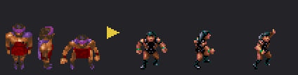 |
| 448 | human woman | the party | the Obsidian Edition's figure | done, seen in the game | 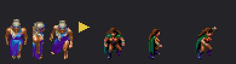 |
| 592 | dwarf man | the party | the Obsidian Edition's figure | done, seen in the game | 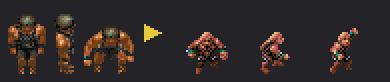 |
| 593 | dwarf woman | the party | the Obsidian Edition's figure | done, seen in the game | 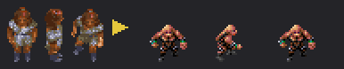 |
| 691 | elf man | the party | the Obsidian Edition's figure | done, seen in the game | 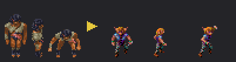 |
| 599 | elf woman | the party | the Obsidian Edition's figure | done, seen in the game | 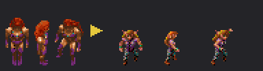 |
| 780 | half-elf man | the party | the Obsidian Edition's figure | done, seen in the game | 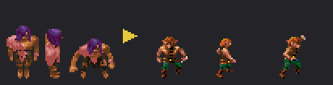 |
| 779 | half-elf woman | the party | the Obsidian Edition's figure | done, seen in the game | 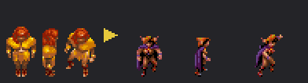 |
| 598 | half-giant man | the party | the Obsidian Edition's figure | done, seen in the game | 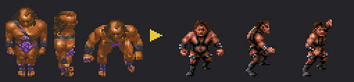 |
| 692 | half-giant woman | the party | the Obsidian Edition's figure | done, seen in the game | 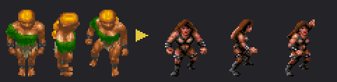 |
| 594 | halfling man | the party | the Obsidian Edition's figure | done, seen in the game | 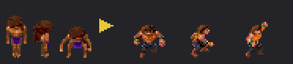 |
| 595 | halfling woman | the party | the Obsidian Edition's figure | done, seen in the game | 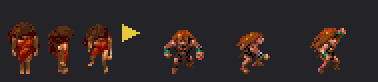 |
| 596 | mul | the party | the Obsidian Edition's figure | done, seen in the game | 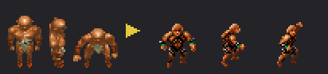 |
| 3917 | thri-kreen | the party | the Obsidian Edition's figure | done, seen in the game | 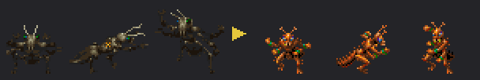 |

## Creature (8)

| WR picture | What it is | Used for | Change | Status | Before → after |
|---|---|---|---|---|---|
| 915 | water elemental | water elemental | SL figure swapped in | done | 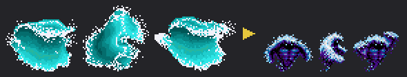 |
| 2538 | air elemental | air elemental | SL figure swapped in | done | 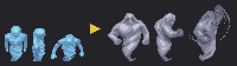 |
| 2540 | fire elemental | fire elemental | SL figure swapped in | done | 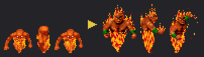 |
| 1881 | earth elemental | earth elemental | SL figure swapped in | done | 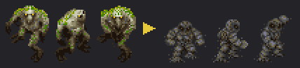 |
| 2425 | defiler | defiler | SL figure swapped in | done | 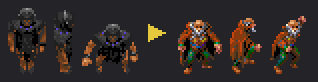 |
| 3893 | shadow | shadow | SL figure swapped in | done | 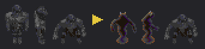 |
| 2409 | notaku | notaku | SL figure swapped in | done | 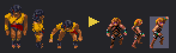 |
| 2420 | templar (purple robe) | templar (purple robe) | SL figure swapped in | done | 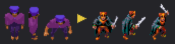 |

## No SL equivalent (45)

| WR picture | What it is | Used for | Change | Status | Before → after |
|---|---|---|---|---|---|
| 693 | magma golem (orange blob giant) | magma golem | WR's own art restyled | restyled | 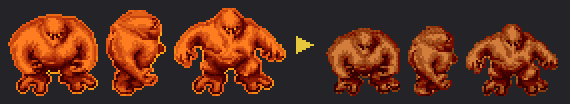 |
| 716 | beggar, seated | beggar | WR's own art restyled | restyled | 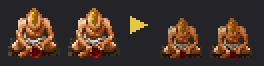 |
| 1753 | skeleton (white bones) | skeleton | WR's own art restyled | restyled | 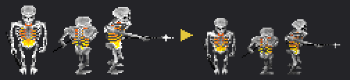 |
| 1754 | skeleton warrior, red cloak, sword | skeletonwarrior x3 | WR's own art restyled | restyled | 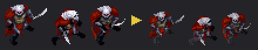 |
| 1755 | yuan-ti (purple serpent) | yuan-ti x2 | WR's own art restyled | restyled | 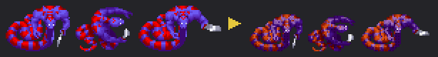 |
| 1756 | giant snake (white) | giant snake x3 | WR's own art restyled | restyled | 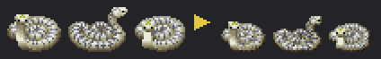 |
| 1757 | snake (orange) | kartang | WR's own art restyled | restyled | 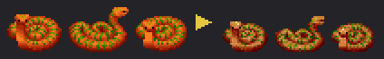 |
| 1758 | snake (teal) | kartang, traxiss | WR's own art restyled | restyled | 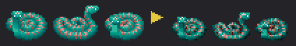 |
| 2345 | sundew (plant blob) | sundew | WR's own art restyled | restyled | 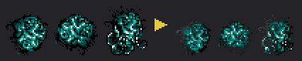 |
| 2394 | obsidian golem (black) | obsidian golem | WR's own art restyled | restyled | 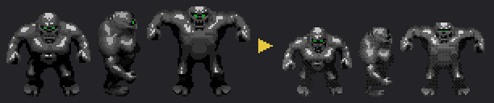 |
| 2403 | snappersaw (spiky plant) | snappersaw | WR's own art restyled | restyled | 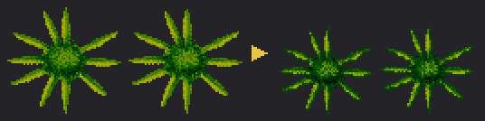 |
| 2526 | mushroom lady, crouched | mushroom lady | WR's own art restyled | restyled | 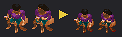 |
| 2537 | aurumvorax (small golden beast) | aurumvorax | WR's own art restyled | restyled | 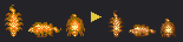 |
| 2539 | soulshard (grey stone man) | soulshard | WR's own art restyled | restyled | 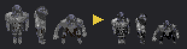 |
| 2554 | great feyr (tentacled maw) | great feyr x2, greater feyr | WR's own art restyled | restyled | 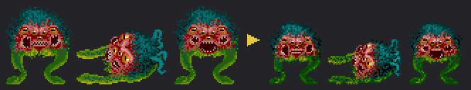 |
| 2555 | umber hulk | umber hulk x3 | WR's own art restyled | restyled | 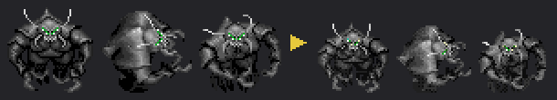 |
| 2556 | shambling mound (green) | shambling mound | WR's own art restyled | restyled | 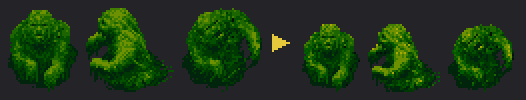 |
| 2570 | Zorani, seated cross-legged | zorani | WR's own art restyled | restyled | 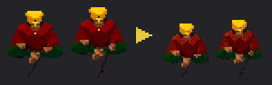 |
| 2843 | yuan-ti (red and gold serpent) | yuan-ti | WR's own art restyled | restyled | 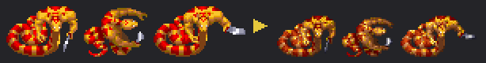 |
| 2844 | yuan-ti (red serpent) | yuan-ti | WR's own art restyled | restyled | 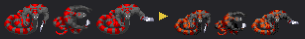 |
| 2845 | serpent (purple) | tantris | WR's own art restyled | restyled | 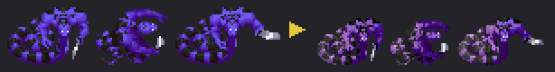 |
| 2846 | serpent (teal) | jestris | WR's own art restyled | restyled | 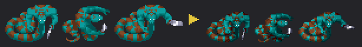 |
| 2847 | serpent (orange) | solurnis | WR's own art restyled | restyled | 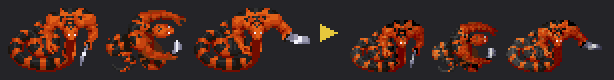 |
| 2849 | serpent (green) | senturnis | WR's own art restyled | restyled | 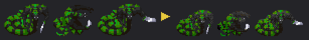 |
| 2850 | verini (tan ape-lizard) | guard x2, verini x2 | WR's own art restyled | restyled | 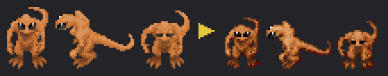 |
| 2852 | verini (yellow) | prosser, verini child, winter | WR's own art restyled | restyled | 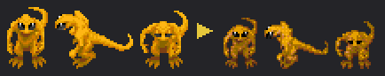 |
| 2853 | verini (dark red) | galinix, rhone, silvan, speaker | WR's own art restyled | restyled | 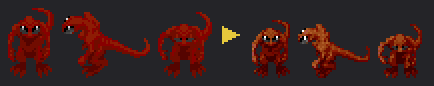 |
| 2854 | verini (grey) | nortemus, zydeko | WR's own art restyled | restyled | 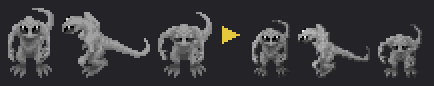 |
| 2855 | verini (white) | fori | WR's own art restyled | restyled |  |
| 2858 | verini (green) | elovan, farmer, xarax | WR's own art restyled | restyled |  |
| 2859 | verini (orange) | guard, jakath, verini x2 | WR's own art restyled | restyled |  |
| 2860 | verini (purple) | kell, yerath | WR's own art restyled | restyled |  |
| 2861 | verini (red) | brotel, guard x2, talo | WR's own art restyled | restyled |  |
| 2863 | verini (brown) | guard x3, verini | WR's own art restyled | restyled |  |
| 2884 | mind flayer, green robe | mindflayer | WR's own art restyled | restyled |  |
| 2885 | mind flayer, pink robe | mindflayer x3 | WR's own art restyled | restyled |  |
| 2887 | mind flayer, orange robe | mind flayer | WR's own art restyled | restyled |  |
| 2888 | mind flayer, red robe | mind flayer | WR's own art restyled | restyled |  |
| 2889 | mind flayer, teal robe | mindflayer | WR's own art restyled | restyled |  |
| 2890 | mind flayer, black robe | prim | WR's own art restyled | restyled |  |
| 2891 | mind flayer, purple robe | mind flayer, mindflayer x6 | WR's own art restyled | restyled |  |
| 2895 | yuan-ti (white serpent) | yuan-ti | WR's own art restyled | restyled |  |
| 3461 | Sirah, crouched | sirah | WR's own art restyled | restyled |  |
| 3509 | tree creature |  | WR's own art restyled | restyled |  |
| 3866 | Generoe, plant woman | generoe | WR's own art restyled | restyled |  |

## Map artwork (squashed) (60)

| WR picture | What it is | Used for | Change | Status | Before → after |
|---|---|---|---|---|---|
| 1 | map object | placed 1 times in Tyr | lowered to two-thirds toward its base | done, seen in the game |  |
| 2 | map object | placed 1 times in Tyr | lowered to two-thirds toward its base | done, seen in the game |  |
| 243 | map object | placed 14 times in Tyr | lowered to two-thirds toward its base | done, seen in the game |  |
| 252 | map object | placed 4 times in Tyr | lowered to two-thirds toward its base | done, seen in the game |  |
| 255 | map object | placed 1 times in Tyr | lowered to two-thirds toward its base | done, seen in the game |  |
| 327 | map object | placed 3 times in Tyr | lowered to two-thirds toward its base | done, seen in the game |  |
| 341 | map object | placed 8 times in Tyr | lowered to two-thirds toward its base | done, seen in the game |  |
| 449 | map object | placed 1 times in Tyr | lowered to two-thirds toward its base | done, seen in the game |  |
| 455 | map object | placed 6 times in Tyr | lowered to two-thirds toward its base | done, seen in the game |  |
| 516 | map object | placed 9 times in Tyr | lowered to two-thirds toward its base | done, seen in the game |  |
| 519 | map object | placed 3 times in Tyr | lowered to two-thirds toward its base | done, seen in the game |  |
| 520 | map object | placed 2 times in Tyr | lowered to two-thirds toward its base | done, seen in the game |  |
| 521 | map object | placed 1 times in Tyr | lowered to two-thirds toward its base | done, seen in the game |  |
| 524 | map object | placed 1 times in Tyr | lowered to two-thirds toward its base | done, seen in the game |  |
| 525 | map object | placed 1 times in Tyr | lowered to two-thirds toward its base | done, seen in the game |  |
| 530 | map object | placed 1 times in Tyr | lowered to two-thirds toward its base | done, seen in the game |  |
| 531 | map object | placed 1 times in Tyr | lowered to two-thirds toward its base | done, seen in the game |  |
| 542 | map object | placed 6 times in Tyr | lowered to two-thirds toward its base | done, seen in the game |  |
| 547 | map object | placed 3 times in Tyr | lowered to two-thirds toward its base | done, seen in the game |  |
| 703 | map object | placed 1 times in Tyr | lowered to two-thirds toward its base | done, seen in the game |  |
| 2215 | map object | placed 5 times in Tyr | lowered to two-thirds toward its base | done, seen in the game |  |
| 2219 | map object | placed 4 times in Tyr | lowered to two-thirds toward its base | done, seen in the game |  |
| 2226 | map object | placed 4 times in Tyr | lowered to two-thirds toward its base | done, seen in the game |  |
| 2352 | map object | placed 1 times in Tyr | lowered to two-thirds toward its base | done, seen in the game |  |
| 2355 | map object | placed 3 times in Tyr | lowered to two-thirds toward its base | done, seen in the game |  |
| 2359 | map object | placed 1 times in Tyr | lowered to two-thirds toward its base | done, seen in the game |  |
| 2360 | map object | placed 1 times in Tyr | lowered to two-thirds toward its base | done, seen in the game |  |
| 2361 | map object | placed 3 times in Tyr | lowered to two-thirds toward its base | done, seen in the game |  |
| 2365 | map object | placed 1 times in Tyr | lowered to two-thirds toward its base | done, seen in the game |  |
| 2371 | map object | placed 1 times in Tyr | lowered to two-thirds toward its base | done, seen in the game |  |
| 2374 | map object | placed 1 times in Tyr | lowered to two-thirds toward its base | done, seen in the game |  |
| 2375 | map object | placed 1 times in Tyr | lowered to two-thirds toward its base | done, seen in the game |  |
| 2376 | map object | placed 1 times in Tyr | lowered to two-thirds toward its base | done, seen in the game |  |
| 2377 | map object | placed 1 times in Tyr | lowered to two-thirds toward its base | done, seen in the game |  |
| 2379 | map object | placed 1 times in Tyr | lowered to two-thirds toward its base | done, seen in the game |  |
| 2581 | map object | placed 1 times in Tyr | lowered to two-thirds toward its base | done, seen in the game |  |
| 2586 | map object | placed 1 times in Tyr | lowered to two-thirds toward its base | done, seen in the game |  |
| 2587 | map object | placed 2 times in Tyr | lowered to two-thirds toward its base | done, seen in the game |  |
| 2817 | map object | placed 4 times in Tyr | lowered to two-thirds toward its base | done, seen in the game |  |
| 2818 | map object | placed 3 times in Tyr | lowered to two-thirds toward its base | done, seen in the game |  |
| 2819 | map object | placed 1 times in Tyr | lowered to two-thirds toward its base | done, seen in the game |  |
| 2820 | map object | placed 2 times in Tyr | lowered to two-thirds toward its base | done, seen in the game |  |
| 2822 | map object | placed 2 times in Tyr | lowered to two-thirds toward its base | done, seen in the game |  |
| 2828 | map object | placed 1 times in Tyr | lowered to two-thirds toward its base | done, seen in the game |  |
| 2829 | map object | placed 5 times in Tyr | lowered to two-thirds toward its base | done, seen in the game |  |
| 2835 | map object | placed 2 times in Tyr | lowered to two-thirds toward its base | done, seen in the game |  |
| 2836 | map object | placed 1 times in Tyr | lowered to two-thirds toward its base | done, seen in the game |  |
| 2838 | map object | placed 3 times in Tyr | lowered to two-thirds toward its base | done, seen in the game |  |
| 2839 | map object | placed 3 times in Tyr | lowered to two-thirds toward its base | done, seen in the game |  |
| 2841 | map object | placed 2 times in Tyr | lowered to two-thirds toward its base | done, seen in the game |  |
| 2899 | map object | placed 1 times in Tyr | lowered to two-thirds toward its base | done, seen in the game |  |
| 2923 | map object | placed 1 times in Tyr | lowered to two-thirds toward its base | done, seen in the game |  |
| 2924 | map object | placed 1 times in Tyr | lowered to two-thirds toward its base | done, seen in the game |  |
| 2925 | map object | placed 1 times in Tyr | lowered to two-thirds toward its base | done, seen in the game |  |
| 2926 | map object | placed 1 times in Tyr | lowered to two-thirds toward its base | done, seen in the game |  |
| 3262 | map object | placed 1 times in Tyr | lowered to two-thirds toward its base | done, seen in the game |  |
| 3263 | map object | placed 1 times in Tyr | lowered to two-thirds toward its base | done, seen in the game |  |
| 3554 | map object | placed 6 times in Tyr | lowered to two-thirds toward its base | done, seen in the game |  |
| 3555 | map object | placed 1 times in Tyr | lowered to two-thirds toward its base | done, seen in the game |  |
| 3559 | map object | placed 4 times in Tyr | lowered to two-thirds toward its base | done, seen in the game |  |

