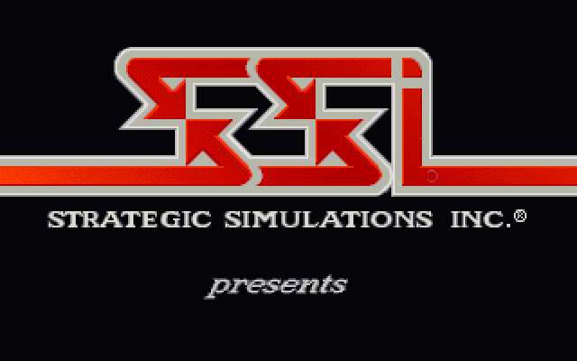
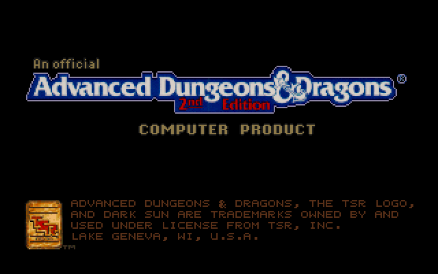

# Status

## Shattered Lands (GOG 1.10, DSUN.EXE 611,408 bytes)

**The intro runs**: the SSI logo and the AD&D licence screen are drawn by the
recompiled game, timed by its own music sequencer.

- Image: 52 overlay modules loaded, 935 stubs patched; Borland's overlay
  manager is kept from starting (its three entry points are native no-ops).
- Functions: ~2,370 found, ~178,000 instructions, 134 jump tables; all lift
  with no unhandled instructions.
- Start-up: Borland's run-time, SSI's VMEM on XMS, the GFF files, the save
  copy (DARKSAVE.GFF to DARKRUN.GFF), mode 13h, the keyboard and mouse hooks.
- Sound: the 16 Miles AIL 2 drivers in RESOURCE.GFF are translated too and run
  where the game loads them. The music driver (Sound Blaster Pro FM) runs
  against an emulated FM chip (timers, status, the SB Pro mixer): sequencing,
  timing and the XMIDI callbacks the intro waits on all work, but the FM
  register writes are not synthesised yet, so it is silent. The digital driver
  answers natively and plays nothing.
- The runtime supplies its own SOUND.CFG (GOG's selects an MT-32, whose
  instrument file GOG does not ship).

## Next

- Run past the intro to the title menu; character creation; the first region.
- FM synthesis (an OPL3 emulator fed with the register writes), then the
  Sound Blaster DSP and DMA for digital sound.
- Clean up misses.txt handling (only real entry points should be kept).
- Windows build (MinGW cross-compile).

## Wake of the Ravager

Not started.
