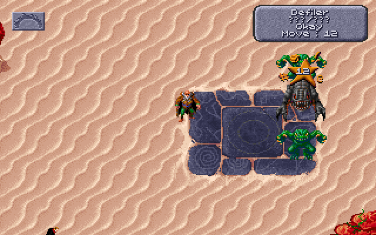
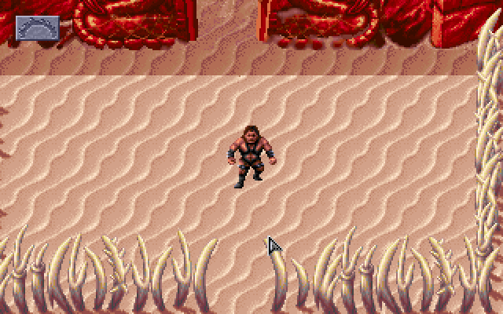
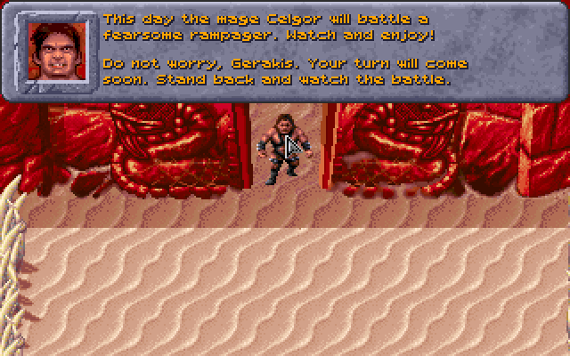
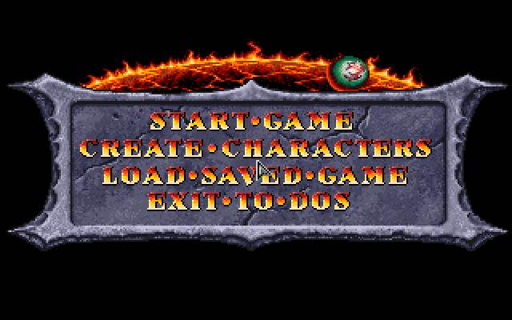
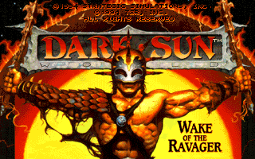
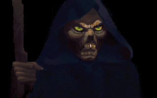
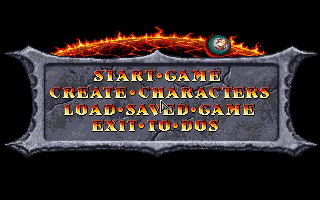
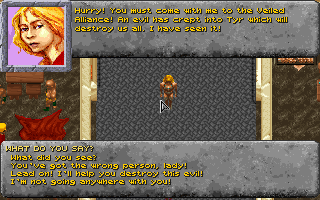

# Status

## Shattered Lands (GOG 1.10, DSUN.EXE 611,408 bytes)

**The game is in play.** The intro (SSI logo, AD&D screen, title card,
cinematic, scroll; Esc skips it), the main menu, START GAME, the decree and
the gladiators' cinematic, the first scene in the arena of Draj with its
dialogue, the scripted fight of Celgor the defiler against the rampager (the
combat view, turn by turn), and the party at the gate waiting to be moved: all
with no misses and no stack faults.

Clicking on the sand walks the party into the arena, the map scrolling with
it. CREATE CHARACTERS opens the roster (VIEW CHARACTER).

- Image: 52 overlay modules loaded, 935 stubs patched; Borland's overlay
  manager is kept from starting (its three entry points are native no-ops).
- Functions: ~2,370 found, ~178,000 instructions, 134 jump tables; all lift
  with no unhandled instructions.
- Start-up: Borland's run-time, SSI's VMEM on XMS, the GFF files, the save
  copy (DARKSAVE.GFF to DARKRUN.GFF), mode 13h, the keyboard and mouse hooks.
- Sound: the 16 Miles AIL 2 drivers in RESOURCE.GFF are translated too and run
  where the game loads them. Music: the Sound Blaster Pro FM driver runs
  against an emulated FM chip at its 120 Hz, and its register writes go to
  Nuked OPL3 and out through SDL (or to a file with `--wav`); the note log
  shows a drum intro and then the theme's melody and bass (not yet checked by
  ear). Digital sound: the Sound Blaster Pro digital driver runs against an
  emulated DSP, DMA channel 1 and IRQ 5, and streams the game's 8 kHz speech
  and effects into the mix.
- The runtime supplies its own SOUND.CFG (GOG's selects an MT-32, whose
  instrument file GOG does not ship).

## Checks

- `tools/difftest.py` over all 128 code segments: 28,894 distinct
  instructions, each lifted alone and run against Unicorn's x86 on two
  random register sets. One real disagreement (`imul r32, imm` with a
  sign-extended immediate), fixed by `patches/pcrecomp/0001`; the rest are
  the `mov r, cs` probe artefact. The same over Wake of the Ravager's 127
  segments: nothing but that artefact (a stray `lar` decoded from data in
  two segments needed a stub in the harness to let them build).
- The stack audit (`tools/lift.py --spcheck`, built into its own program:
  `DSUN=build/cmake-sp/dsun python3 tests/run.py`) over the Shattered
  Lands cases: intro, menu, start and the load report nothing. The fight,
  the walk and the save report one family of entries: forty points inside
  the map blitter at `1CAE` that data points at, which the finder made
  entries of, so a jump to one from the routine around it is lifted as a
  tail call; each ends in that routine's epilogue and so leaves the stack
  as the routine would, which the audit sees as the callee moving SP. The
  same for `17B4E` on the creation screen. The idiom is sound (the caller
  returns right after the tail call, which is where it was going), not a
  translation fault.
- The dice against DOSBox: the same scripted arena fight in DOSBox 0.74
  (the mod loaded, the Loader attached, driven by xdotool under Xvfb) and
  in this program with `DS_CLOCK` pinned to the second DOSBox started: the
  same saving throws (7, 5, 7, 10), the same damage, the same deaths, roll
  for roll. The game seeds its dice from the time of day once, at the main
  menu; the runs differ when the clocks do. `tools/dosbox_compare.sh` runs
  it. The Loader's log from this build lacks the lines it works out from
  the address `rand()` was called from (the lifter pushes a sentinel return
  address): see docs/DESIGN.md, "The mod".
- The stack audit over Wake of the Ravager's two cases: the sequel's
  Borland run-time at the same addresses as Shattered Lands' (the
  struct-by-value push, the start-up's argv builders) is the only thing it
  reports, and is on the audit's known-good list for both games.
- The character transfer against DOSBox: the same Shattered Lands save
  (the arena party of four, `tests/ref/arena.sav`) carried into the
  sequel's roster by the translated CHARTRAN.EXE and by the original under
  DOSBox 0.74 gives the same `CHARSAVE.GFF`, byte for byte, and the same
  exit code (211, the utility's own).
- Ten scripted regression tests (`tests/run.py`): intro, menu, start, walk,
  create (a character rolled on CREATE CHARACTERS, kept, and the game started
  with it),
  save1-write and save2-load (Esc at the arena opens "Exit: save game?";
  the save is named and written, the game exits to DOS; the next run
  loads it from the title menu and is back at the arena), the two
  Wake of the Ravager cases, and transfer (the utility carries the arena
  party into the sequel's roster, its three screens checked against
  references).

## Next

- Out of the pens: the way out is story (the pens' tasks after the arena),
  not a walk; a scripted route or a save from later in the game is needed
  to exercise it. Seven minutes of wandering the arena, with the Effects
  and inventory screens and the figure's menu opened, found no misses.
- Listen to the output on a machine with a sound device; compare timing
  against DOSBox.
- Clean up misses.txt handling (only real entry points should be kept).
- Run the Windows build on a Windows machine (it cross-compiles; untested
  there).
- Wake of the Ravager: further into Tyr; CD volume through the mixer.

Character creation turned up a mouse-driver bug: INT 33h functions 5 and 6
(button press and release information) answered with the button state
where the function number was tested, so the roster's pop-up menu (a
right click on a slot: NEW / ADD / CANCEL) never saw a click. They now
answer with the count and the position of the last press or release, as
the driver does. The input script gained `rclick=` and `rdrag=`.

## One program

Both games are built into the one `dsun`: every generated symbol carries
its game's tag (`ds1_fn_...`, `ds2_drv01_...`), each game is described by
a `GameDesc` (entry point, dispatch table, drivers, whether it has a CD) and
CMake writes the table of the games it found lifts for. The program
recognises a game folder by the size of its `DSUN.EXE`, finds `game/ds1`
and `game/ds2` on its own, and asks with a message box when both are
there. The Windows zip now carries both memory images.

**The character transfer** (Phase 7's party transfer) is the third program
built in: SSI's `CHARTRAN.EXE` from Wake of the Ravager's folder,
unpacked from LZEXE (`tools/unlzexe.py`), translated like the games (303
functions; plain program, no overlays) and started with `--transfer`, or
from the message box when both games are found. It runs in text mode,
which the runtime now draws (80x25 from B800:0000, Spleen's 8x16 font,
the BIOS cursor), with the BIOS character services and DOS console input
and output answered, and both game folders mounted as the `C:\DSUN` and
`C:\RAVAGER` it expects. The arena party goes into the sequel's roster
with the same bytes DOSBox produces (Checks above). What it does not
cover: a party with the Obsidian Edition's own items (the utility is the
original's).

## Shattered Lands with the Obsidian Edition mod

`tools/build_mod.sh` builds the mod's patched game (`DSUNLOG.EXE`) and its
resident helper (`DSCLOG.EXE`) into a program of their own,
`build/cmake-mod/dsun`, run with `--game game/ds1 --build build/ds1mod --cd
<mod>/obsidian-edition/dos` (docs/DESIGN.md, "The mod"). The helper loads
and stays resident, hooks DOS, the keyboard and the mouse, and answers the
patched game's interrupts; the game boots with the mod's data files
through its DOS hook, plays its intro, shows the menu, and START GAME
reaches the arena, where the scripted fight plays out and the party walks
in afterwards (the plain build's `walk` script). The converge loop finds
no missing functions over that 150-second run.

What it took is in the design notes: the frames of the mod's interrupts
carry the real return address and the code after each interrupt follows
where the handler sent the game; the helper's segment-table move is done
to the overlays at build time; its argument-byte calls and its stack-built
far jumps and returns back into the game are recognised; its near calls
check where the callee came back to, as one routine pops its return
address and jumps back through it later. Most of the time went on six ways
the frame's or a return address could be off, each of which sent the game
into the wrong code with a stack that no longer matched.

The mod's Loader reads this program: with the change on the mod
repository's `recompiled` branch (also docs/loader-recompiled.patch) it
finds the memory by the mark at F000:FFC0, attaches to the helper's ring,
and its dice log prints what the helper records: attached to a headless
run during the arena fight (`python3 -m dsloader dicelog --pid $(pgrep -x
dsun)`), it printed the announcer's lines, the party's kit lines, and the
fight's saving throws, damage and hit points as they happened.

The creation screen works in this build too (the mod's STORE and RECALL
probe stands in for the `mov cx` that sizes the click routine's switch; the
finder now reads it from the bytes the INT replaced). The walk and the
creation scripts run with no misses.

The mod's releases 2.6.0 and 2.12.1 (84 and then 189 commits past the
version first built here) build and run the same way: `tools/helper_symbols.py`
reads where each helper keeps the routines the builder must know about from
its source, so the moved code needs no table change. 2.12.1 keeps its big
buffers in the HMA through XMS, which the runtime now grants, and intercepts
the C library's heap calls; its 33 KB overlay-buffer reserve is refused
here, as there is no room for it above the overlays, and the helper falls
back to the game's heap as before (the runtime's DOS gives the game 608 KB,
more than DOSBox does, so nothing is lost). Its scene-player check turned
up a runtime fault: a loop closed through an interrupt whose handler keeps
interrupts off never let the timer through, and the screen stayed black;
pending interrupts are now delivered as soon as a handler's iret has them
on again. The 2.12.1 Loader attaches to the running program and reads the
whole fight, with the same dice as DOSBox rolls for the same clock. The
finder now follows the jumps the mod's INTs stand in for (`or ax,ax / jnz`
sites), whose targets its handlers reach by moving the return address.

The helper gets both its upper memory blocks (the ring below the BIOS area,
the panel in the HMA), so the combat-log panel can be drawn once the Loader
asks for it.

The Loader starts this program instead of DOSBox once told where it is
(`dsloader launch --recompiled <path to dsun>`, on the mod repository's
`recompiled` branch): `launch`, `play` and the window's "Start the game"
run it with the game's folder and the mod's `dos` folder, and attach as
they do to DOSBox. The program expects its memory image at `build/ds1mod`
beside itself, as the zip lays it out.

Not yet: the combat-log panel seen on screen through the Loader's window
(it needs a display and the viewer; the helper has the memory for it now).

## Wake of the Ravager (GOG 1.1, DSUN.EXE 634,416 bytes)

The same pipeline, pointed at `game/ds2` with `--args "-W0 -L"` and the CD
folder from `tools/cd_extract.py` on `D:`. 49 overlay modules, ~2,540
functions, 16 Miles drivers. It plays: SSI logo, title, the opening
cinematic from `1.FLI`, the main menu, START GAME, the narrated cinematic,
and the first scene in Tyr with its opening conversation, the speech
streaming through the Sound Blaster. Holding Shift skips the intro (the
game polls the BIOS shift state), so the menu is reachable in 8 seconds.
Its music is CD audio: `runtime/cd.c` answers MSCDEX's device requests
(table of contents from the lengths of GOG's `MUSIC/TrackNN.ogg`, PLAY,
STOP, RESUME, Q-channel position) and decodes the track being played
with stb_vorbis into the mix. A recording of the title screen matches
the decoded track 37 sample for sample (correlation 0.99).

 
 

What it needed beyond Shattered Lands:

- Its `int86x` builds its interrupt stub on the stack in more shapes
  (`push bp / int / pop bp / retf`, `mov bp,[bp+d8] / int / retf n`);
  dispatch recognises all of them and no longer records stack addresses
  as missing functions.
- Its timer and keyboard handlers (installed through registers, not
  immediates) and a few pointer-called helpers were only found by the
  run-time miss list; four converge rounds in all.
- The BIOS keyboard handler keeps the shift state at 0040:0017.
- Its own `_INIT_` table, GPL handler table (DGROUP:30A) and overlay
  manager addresses in `tools/find_funcs.py` and `tools/lift.py`.

Two regression cases: `wotr-intro` (logo, title, cinematic, menu) and
`wotr-start` (Shift, START GAME, Tyr).

Not yet: play beyond the first conversation; the save-game folder (it writes `darkrun.gff` and reads
`CHARSAVE.GFF` in the game folder, as DOS did).
